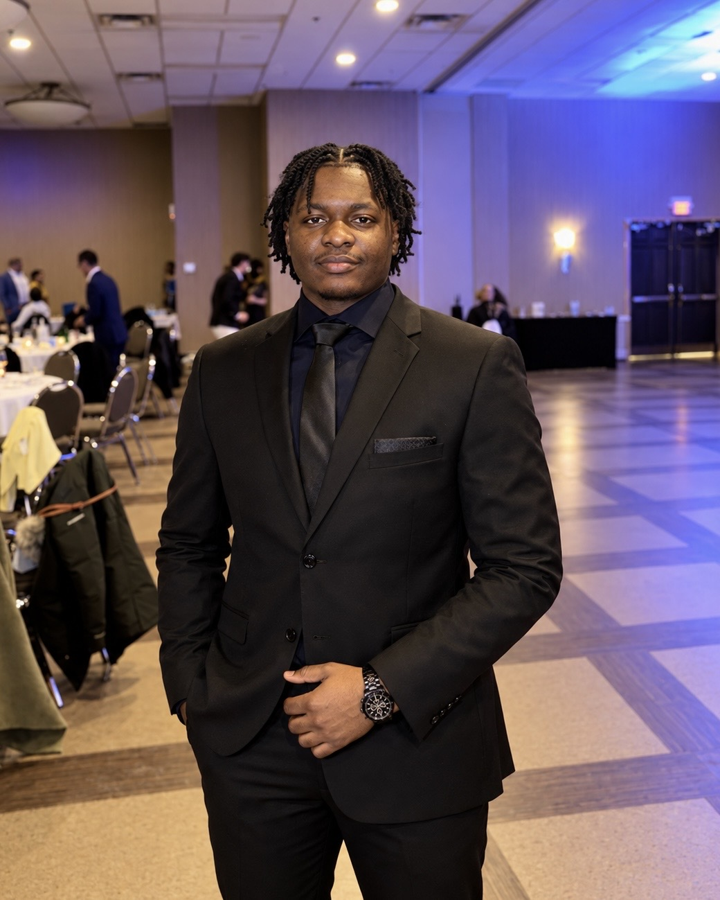
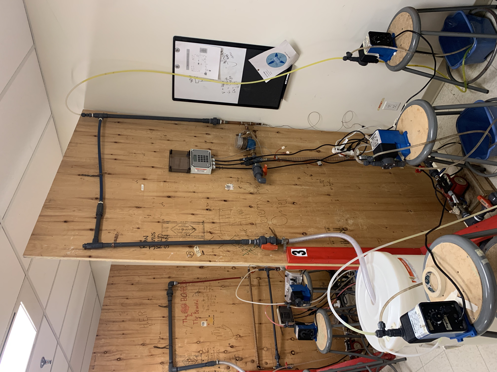

# Sonali Brighton 

Chemical Engineering student at Lakehead University, based in Scarborough, ON, with interests in process engineering, manufacturing, process design, automation, and continuous improvement. Project and internship experience includes process engineering in a PCB manufacturing environment, pilot-scale process control, analytical laboratory work, and chemical process design. Recipient of the Chemical Institute of Canada Book Prize and named to Seneca Polytechnic’s President’s Honour List in Winter 2024.

## Experience
- Process Engineering Intern, TTM Technologies

## Projects
- Design of a Hydrometallurgical Process for Critical Material Recovery from Black Mass
- Trace Metal and VOC Analysis of Latex Paint
- Pilot-Scale Process Control and Instrumentation Project
- Qualification & Implementation of Automation for Core Imaging Process
- Chemical Reactor Kinetics Laboratory

## Software Skills
Aspen Plus, Aspen HYSYS, MATLAB, AutoCAD, VBA Macros, MS Office

## Technical Skills
Process Simulation, PFDs, P&IDs, Troubleshooting, Reactor Kinetics, Process Control

## Laboratory Skills
ICP-OES, HPLC, Colorimetry, Conductivity, Sample Preparation

## Education
- Lakehead University, B.Eng. Chemical Engineering
- Seneca Polytechnic, Chemical Engineering Advanced Diploma

## Project: Design of a Hydrometallurgical Process for Critical Material Recovery from Black Mass

**Current Focus:**  

This five-member capstone project is currently in the preliminary design phase, with a focus on selecting appropriate unit operations, researching separation efficiencies, and developing an initial Aspen Plus model. The group has also begun conducting material and energy balances based on a comparable industrial processing capacity.

## Project: Trace Metal and VOC Analysis of Latex Paint

**Focus:** 

Conducted a multi-week analytical research project with two other group members to evaluate trace metals and volatile organic compounds (VOCs) in commercially available water-based latex paint. Prepared and analyzed samples using ICP-OES for elemental analysis and gas chromatography for VOC characterization, while developing calibration methods and evaluating analytical performance. The study also compared green-certified and non-green-certified paint products to investigate differences in potentially hazardous constituents.

[View Project Results & Conclusion](TCA%20Heavy%20Metal%20&%20VOC%20Analysis%20Poster.pdf)

## Project: Pilot-Scale Process Control and Instrumentation Project

 **Focus:** 

This three-member capstone project involved recommissioning and modifying a recirculating pilot plant, calibrating flow and concentration instrumentation, developing an updated Process & Instrumentation Diagram (P&ID), assembling a PID temperature-control system, and implementing PLC-based on-off concentration control. We also evaluated closed-loop response, disturbance recovery, and process variability using control charts and statistical performance measures.

[View Pilot-Scale Process & Instrumentation Diagram (P&ID)](Process%20and%20Instrumentation%20Diagram.pdf)
[View Pilot-Scale Manual](DMK%20Hydro%20-%20PID%20%26%20Combined%20Control%20Study.pdf)
[View Pre-Recommissioning Pilot Plant Equipment & Operations Manual](Operation%20Manual%20CNG533%20-%20final%20version.pdf)

## Project: Qualification & Implementation of Automation for Core Imaging Process

**Focus:**

Supported the qualification and implementation of an automated Laser Direct Imaging workflow within a PCB manufacturing environment. The project involved coordinating equipment integration with technical teams, conducting production qualification testing across multiple material configurations, supporting troubleshooting and system setup, and developing operator procedures and training. The implementation focused on reducing operator intervention, standardizing panel handling and cleaning, improving equipment utilization, and supporting improvements in throughput, yield, and manufacturing consistency.

[View Redacted LDI Automation Portfolio PDF](LDI_Automation_Portfolio_Redacted.pdf)
